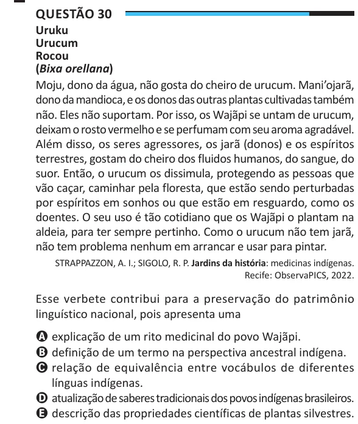

Texto extraído (pode conter ruído)

Questão 30  
Uruku  
Urucum  
Rocou  
(Bixa orellana)  
Moju, dono da água, não gosta do cheiro de urucum. Mani’ojarã,  
dono da mandioca, e os donos das outras plantas cultivadas também  
não. Eles não suportam. Por isso, os Wajãpi se untam de urucum,  
deixam o rosto vermelho e se perfumam com seu aroma agradável.  
Além disso, os seres agressores, os jarã (donos) e os espíritos  
terrestres, gostam do cheiro dos fluidos humanos, do sangue, do  
suor. Então, o urucum os dissimula, protegendo as pessoas que  
vão caçar, caminhar pela floresta, que estão sendo perturbadas  
por espíritos em sonhos ou que estão em resguardo, como os  
doentes. O seu uso é tão cotidiano que os Wajãpi o plantam na  
aldeia, para ter sempre pertinho. Como o urucum não tem jarã,  
não tem problema nenhum em arrancar e usar para pintar.  
STRAPPAZZON, A. I.; SIGOLO, R. P. Jardins da história: medicinas indígenas.  
Recife: ObservaPICS, 2022.  
Esse verbete contribui para a preservação do patrimônio  
linguístico nacional, pois apresenta uma  
A explicação de um rito medicinal do povo Wajãpi.  
B definição de um termo na perspectiva ancestral indígena.  
C relação de equivalência entre vocábulos de diferentes  
línguas indígenas.  
D atualização de saberes tradicionais dos povos indígenas brasileiros.  
E descrição das propriedades científicas de plantas silvestres.

