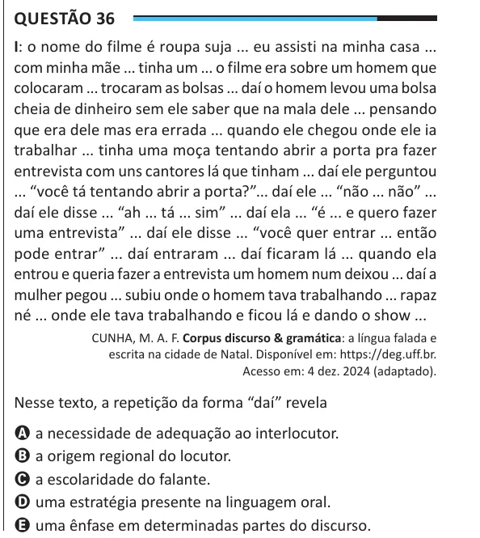

Texto extraído (pode conter ruído)

Questão 36  
I: o nome do filme é roupa suja ... eu assisti na minha casa ...  
com minha mãe ... tinha um ... o filme era sobre um homem que  
colocaram ... trocaram as bolsas ... daí o homem levou uma bolsa  
cheia de dinheiro sem ele saber que na mala dele ... pensando  
que era dele mas era errada ... quando ele chegou onde ele ia  
trabalhar ... tinha uma moça tentando abrir a porta pra fazer  
entrevista com uns cantores lá que tinham ... daí ele perguntou  
... “você tá tentando abrir a porta?”... daí ele ... “não ... não” ...  
daí ele disse ... “ah ... tá ... sim” ... daí ela ... “é ... e quero fazer  
uma entrevista” ... daí ele disse ... “você quer entrar ... então  
pode entrar” ... daí entraram ... daí ficaram lá ... quando ela  
entrou e queria fazer a entrevista um homem num deixou ... daí a  
mulher pegou ... subiu onde o homem tava trabalhando ... rapaz  
né ... onde ele tava trabalhando e ficou lá e dando o show ...  
CUNHA, M. A. F. Corpus discurso & gramática: a língua falada e  
escrita na cidade de Natal. Disponível em: https://deg.uff.br.  
Acesso em: 4 dez. 2024 (adaptado).  
Nesse texto, a repetição da forma “daí” revela  
A a necessidade de adequação ao interlocutor.  
B a origem regional do locutor.  
C a escolaridade do falante.  
D uma estratégia presente na linguagem oral.  
E uma ênfase em determinadas partes do discurso.

