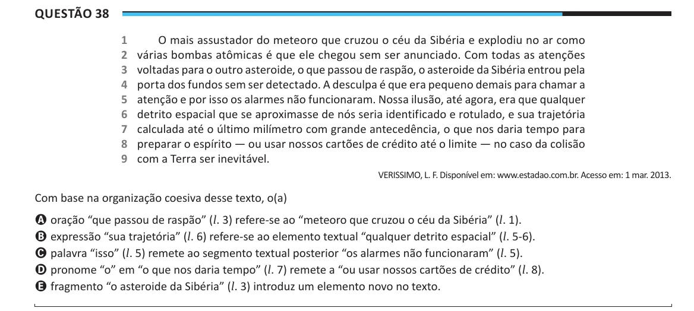

Texto extraído (pode conter ruído)

Questão 38  
1  
O mais assustador do meteoro que cruzou o céu da Sibéria e explodiu no ar como  
2  
várias bombas atômicas é que ele chegou sem ser anunciado. Com todas as atenções  
3  
voltadas para o outro asteroide, o que passou de raspão, o asteroide da Sibéria entrou pela  
4  
porta dos fundos sem ser detectado. A desculpa é que era pequeno demais para chamar a  
5  
atenção e por isso os alarmes não funcionaram. Nossa ilusão, até agora, era que qualquer  
6  
detrito espacial que se aproximasse de nós seria identificado e rotulado, e sua trajetória  
7  
calculada até o último milímetro com grande antecedência, o que nos daria tempo para  
8  
preparar o espírito — ou usar nossos cartões de crédito até o limite — no caso da colisão  
9  
com a Terra ser inevitável.  
VERISSIMO, L. F. Disponível em: www.estadao.com.br. Acesso em: 1 mar. 2013.  
Com base na organização coesiva desse texto, o(a)  
A oração “que passou de raspão” (l. 3) refere-se ao “meteoro que cruzou o céu da Sibéria” (l. 1).  
B expressão “sua trajetória” (l. 6) refere-se ao elemento textual “qualquer detrito espacial” (l. 5-6).  
C palavra “isso” (l. 5) remete ao segmento textual posterior “os alarmes não funcionaram” (l. 5).  
D pronome “o” em “o que nos daria tempo” (l. 7) remete a “ou usar nossos cartões de crédito” (l. 8).  
E fragmento “o asteroide da Sibéria” (l. 3) introduz um elemento novo no texto.

