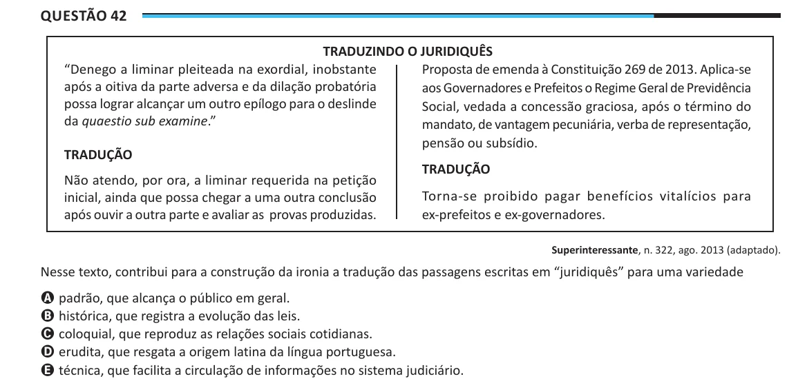

Texto extraído (pode conter ruído)

Questão 42  
TRADUZINDO O JURIDIQUÊS  
“Denego a liminar pleiteada na exordial, inobstante  
Proposta de emenda à Constituição 269 de 2013. Aplica-se  
após a oitiva da parte adversa e da dilação probatória  
aos Governadores e Prefeitos o Regime Geral de Previdência  
possa lograr alcançar um outro epílogo para o deslinde  
Social, vedada a concessão graciosa, após o término do  
da quaestio sub examine.”  
mandato, de vantagem pecuniária, verba de representação,  
pensão ou subsídio.  
TRADUÇãO  
TRADUÇãO  
Não atendo, por ora, a liminar requerida na petição  
Torna-se proibido pagar benefícios vitalícios para  
inicial, ainda que possa chegar a uma outra conclusão  
após ouvir a outra parte e avaliar as provas produzidas.  
ex-prefeitos e ex-governadores.  
Superinteressante, n. 322, ago. 2013 (adaptado).  
Nesse texto, contribui para a construção da ironia a tradução das passagens escritas em “juridiquês” para uma variedade  
A padrão, que alcança o público em geral.  
B histórica, que registra a evolução das leis.  
C coloquial, que reproduz as relações sociais cotidianas.  
D erudita, que resgata a origem latina da língua portuguesa.  
E técnica, que facilita a circulação de informações no sistema judiciário.

