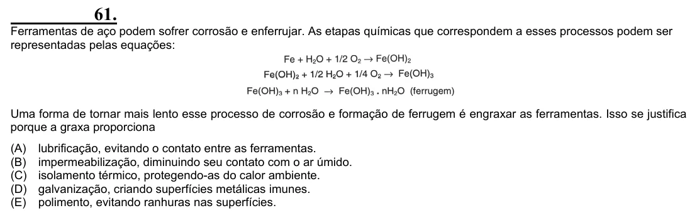

Texto extraído (pode conter ruído)

61.  
Ferramentas de aço podem sofrer corrosão e enferrujar. As etapas químicas que correspondem a esses processos podem ser  
representadas pelas equações:  
Uma forma de tornar mais lento esse processo de corrosão e formação de ferrugem é engraxar as ferramentas. Isso se justifica  
porque a graxa proporciona  
(A)  
lubrificação, evitando o contato entre as ferramentas.  
(B)  
impermeabilização, diminuindo seu contato com o ar úmido.  
(C)  
isolamento térmico, protegendo-as do calor ambiente.  
(D)  
galvanização, criando superfícies metálicas imunes.  
(E)  
polimento, evitando ranhuras nas superfícies.

