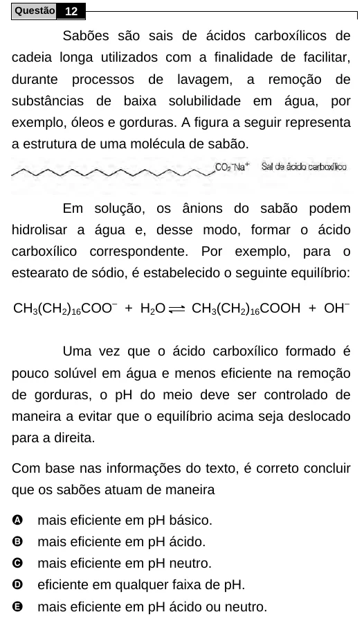

Texto extraído (pode conter ruído)

Questão 12  
Sabões são sais de ácidos carboxílicos de  
cadeia longa utilizados com a finalidade de facilitar,  
durante  
processos  
de  
lavagem,  
a  
remoção  
de  
substâncias de baixa solubilidade em água, por  
exemplo, óleos e gorduras. A figura a seguir representa  
a estrutura de uma molécula de sabão.  
Em solução, os ânions do sabão podem  
hidrolisar a água e, desse modo, formar o ácido  
carboxílico correspondente. Por exemplo, para o  
estearato de sódio, é estabelecido o seguinte equilíbrio:  
CH 3 (CH 2 ) 16 COO – + H 2 O  
CH 3 (CH 2 ) 16 COOH + OH –  
Uma vez que o ácido carboxílico formado é  
pouco solúvel em água e menos eficiente na remoção  
de gorduras, o pH do meio deve ser controlado de  
maneira a evitar que o equilíbrio acima seja deslocado  
para a direita.  
Com base nas informações do texto, é correto concluir  
que os sabões atuam de maneira  
A  
mais eficiente em pH básico.  
B  
mais eficiente em pH ácido.  
C  
mais eficiente em pH neutro.  
D  
eficiente em qualquer faixa de pH.  
E  
mais eficiente em pH ácido ou neutro.

