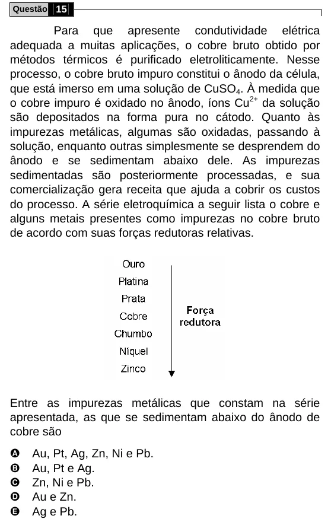

Texto extraído (pode conter ruído)

Questão 15  
Para que apresente condutividade elétrica  
adequada a muitas aplicações, o cobre bruto obtido por  
métodos térmicos é purificado eletroliticamente. Nesse  
processo, o cobre bruto impuro constitui o ânodo da célula,  
que está imerso em uma solução de CuSO 4 . À medida que  
o cobre impuro é oxidado no ânodo, íons Cu 2+ da solução  
são depositados na forma pura no cátodo. Quanto às  
impurezas metálicas, algumas são oxidadas, passando à  
solução, enquanto outras simplesmente se desprendem do  
ânodo e se sedimentam abaixo dele. As impurezas  
sedimentadas são posteriormente processadas, e sua  
comercialização gera receita que ajuda a cobrir os custos  
do processo. A série eletroquímica a seguir lista o cobre e  
alguns metais presentes como impurezas no cobre bruto  
de acordo com suas forças redutoras relativas.  
Entre as impurezas metálicas que constam na série  
apresentada, as que se sedimentam abaixo do ânodo de  
cobre são  
A  
Au, Pt, Ag, Zn, Ni e Pb.  
B  
Au, Pt e Ag.  
C  
Zn, Ni e Pb.  
D  
Au e Zn.  
E  
Ag e Pb.

