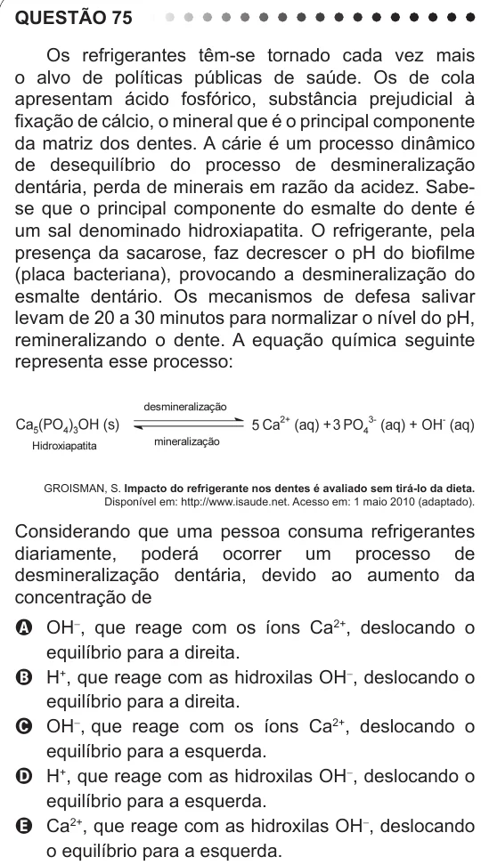

Texto extraído (pode conter ruído)

QUESTÃO 75  
Os refrigerantes têm-se tornado cada vez mais  
o alvo de políticas públicas de saúde. Os de cola  
apresentam ácido fosfórico, substância prejudicial à  
fixação de cálcio, o mineral que é o principal componente  
da matriz dos dentes. A cárie é um processo dinâmico  
de desequilíbrio do processo de desmineralização  
dentária, perda de minerais em razão da acidez. Sabe-  
se que o principal componente do esmalte do dente é  
um sal denominado hidroxiapatita. O refrigerante, pela  
presença da sacarose, faz decrescer o pH do biofilme  
(placa bacteriana), provocando a desmineralização do  
esmalte dentário. Os mecanismos de defesa salivar  
levam de 20 a 30 minutos para normalizar o nível do pH,  
remineralizando o dente. A equação química seguinte  
representa esse processo:  
GROISMAN, S. Impacto do refrigerante nos dentes é avaliado sem tirá-lo da dieta.  
Disponível em: http://www.isaude.net. Acesso em: 1 maio 2010 (adaptado).  
Considerando que uma pessoa consuma refrigerantes  
diariamente, poderá ocorrer um processo de  
desmineralização dentária, devido ao aumento da  
concentração de  
A OH - , que reage com os íons Ca 2+ , deslocando o  
equilíbrio para a direita.  
B H + , que reage com as hidroxilas OH - , deslocando o  
equilíbrio para a direita.  
C OH - , que reage com os íons Ca 2+ , deslocando o  
equilíbrio para a esquerda.  
D H + , que reage com as hidroxilas OH - , deslocando o  
equilíbrio para a esquerda.  
E Ca 2+ , que reage com as hidroxilas OH - , deslocando  
o equilíbrio para a esquerda.

