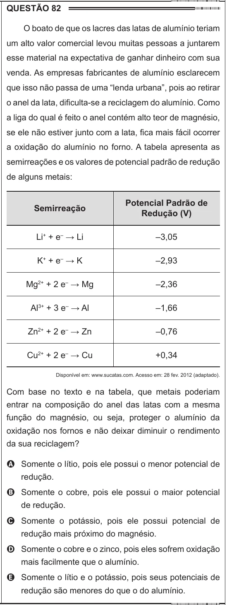

Texto extraído (pode conter ruído)

QUESTÃO 82  
O boato de que os lacres das latas de alumínio teriam  
um alto valor comercial levou muitas pessoas a juntarem  
esse material na expectativa de ganhar dinheiro com sua  
venda. As empresas fabricantes de alumínio esclarecem  
que isso não passa de uma “lenda urbana”, pois ao retirar  
o anel da lata, dificulta-se a reciclagem do alumínio. Como  
a liga do qual é feito o anel contém alto teor de magnésio,  
se ele não estiver junto com a lata, fica mais fácil ocorrer  
a oxidação do alumínio no forno. A tabela apresenta as  
semirreações e os valores de potencial padrão de redução  
de alguns metais:  
Potencial Padrão de  
Semirreação  
Redução (V)  
Li + + e – → Li  
–3,05  
K + + e – → K  
–2,93  
Mg 2+ + 2 e – → Mg  
–2,36  
Al 3+ + 3 e – → Al  
–1,66  
Zn 2+ + 2 e – → Zn  
–0,76  
Cu 2+ + 2 e – → Cu  
+0,34  
Disponível em: www.sucatas.com. Acesso em: 28 fev. 2012 (adaptado).  
Com base no texto e na tabela, que metais poderiam  
entrar na composição do anel das latas com a mesma  
função do magnésio, ou seja, proteger o alumínio da  
oxidação nos fornos e não deixar diminuir o rendimento  
da sua reciclagem?  
A Somente o lítio, pois ele possui o menor potencial de  
redução.  
B Somente o cobre, pois ele possui o maior potencial  
de redução.  
C Somente o potássio, pois ele possui potencial de  
redução mais próximo do magnésio.  
D Somente o cobre e o zinco, pois eles sofrem oxidação  
mais facilmente que o alumínio.  
E Somente o lítio e o potássio, pois seus potenciais de  
redução são menores do que o do alumínio.

