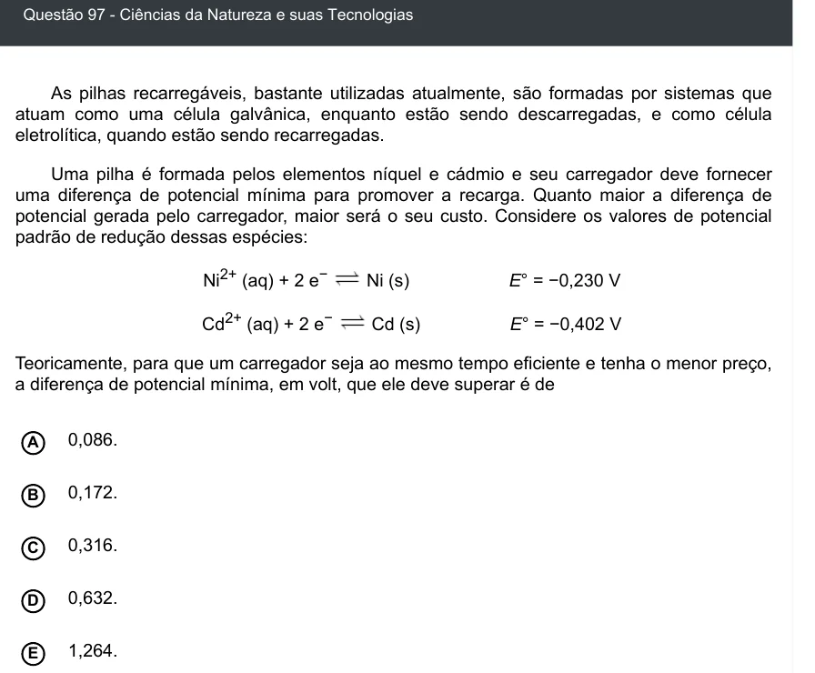

Texto extraído (pode conter ruído)

Questão 97 - Ciências da Natureza e suas Tecnologias  
As pilhas recarregáveis, bastante utilizadas atualmente, são formadas por sistemas que  
atuam como uma célula galvânica, enquanto estão sendo descarregadas, e como célula  
eletrolítica, quando estão sendo recarregadas.  
Uma pilha é formada pelos elementos níquel e cádmio e seu carregador deve fornecer  
uma diferença de potencial mínima para promover a recarga. Quanto maior a diferença de  
potencial gerada pelo carregador, maior será o seu custo. Considere os valores de potencial  
padrão de redução dessas espécies:  
Ni 2+ (aq) + 2 e −  
Ni (s)  
E° = −0,230 V  
Cd 2+ (aq) + 2 e −  
Cd (s)  
E° = −0,402 V  
Teoricamente, para que um carregador seja ao mesmo tempo eficiente e tenha o menor preço,  
a diferença de potencial mínima, em volt, que ele deve superar é de  
A  
0,086.  
0,172.  
B  
0,316.  
C  
D  
0,632.  
1,264.  
E

