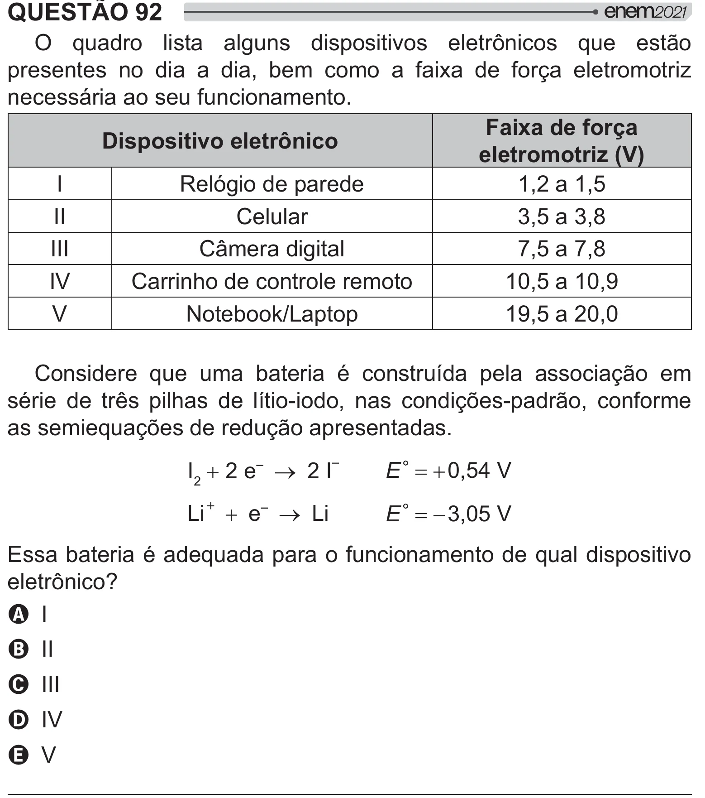

Texto extraído (pode conter ruído)

QUESTÃO 92  
  
       #  "   2   
  
[  
presentes no dia a dia, bem como a faixa de força eletromotriz  
necessária ao seu funcionamento.  
Faixa de força  
Dispositivo eletrônico  
eletromotriz (V)  
I  
Relógio de parede  
1,2 a 1,5  
II  
Celular  
3,5 a 3,8  
III  
Câmera digital  
7,5 a 7,8  
IV  
Carrinho de controle remoto  
10,5 a 10,9  
V  
Notebook/Laptop  
19,5 a 20,0  
Considere que uma bateria é construída pela associação em  
série de três pilhas de lítio-iodo, nas condições-padrão, conforme  
as semiequações de redução apresentadas.  
  
I 2  2 e  o 2 I  
E q  
0,54 V  
  
Li  e  o Li  
E q  
3,05 V  
Essa bateria é adequada para o funcionamento de qual dispositivo  
 2]  
A I  
B II  
C III  
D IV  
E V

