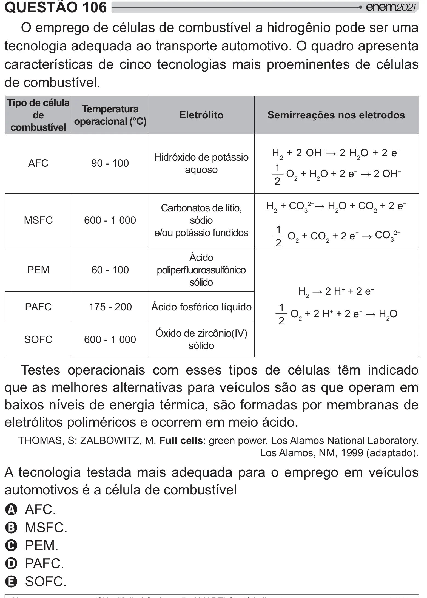

Texto extraído (pode conter ruído)

QUESTÃO 106  
O emprego de células de combustível a hidrogênio pode ser uma  
tecnologia adequada ao transporte automotivo. O quadro apresenta  
características de cinco tecnologias mais proeminentes de células  
de combustível.  
Tipo de célula  
Temperatura  
de  
Eletrólito  
Semirreações nos eletrodos  
operacional (°C)  
combustível  
H 2 + 2 OH  ‘’ 2 O + 2 e   
Hidróxido de potássio  
AFC  
90 - 100  
1  
aquoso  
__  
O 2 + H 2 O + 2 e  ‘’   
2  
H 2 + CO 3” ’ 2 O + CO 2 + 2 e   
Carbonatos de lítio,  
MSFC  
600 - 1 000  
sódio  
1  
__  
e/ou potássio fundidos  
O 2 + CO 2 + 2 e  CO 3”  
2  
Ácido  
PEM  
60 - 100  
## }  >2  
sólido  
H 2  2 H + + 2 e   
PAFC  
175 - 200  
Ácido fosfórico líquido  
1  
__  
O 2 + 2 H + + 2 e  ’ 2 O  
2  
•* 2JK–W  
SOFC  
600 - 1 000  
sólido  
Testes operacionais com esses tipos de células têm indicado  
que as melhores alternativas para veículos são as que operam em  
baixos níveis de energia térmica, são formadas por membranas de  
eletrólitos poliméricos e ocorrem em meio ácido.  
’—˜™?šXK™—!Full cells: green power. Los Alamos National Laboratory.  
Los Alamos, NM, 1999 (adaptado).  
A tecnologia testada mais adequada para o emprego em veículos  
automotivos é a célula de combustível  
A AFC.  
B MSFC.  
C PEM.  
D PAFC.  
E SOFC.

