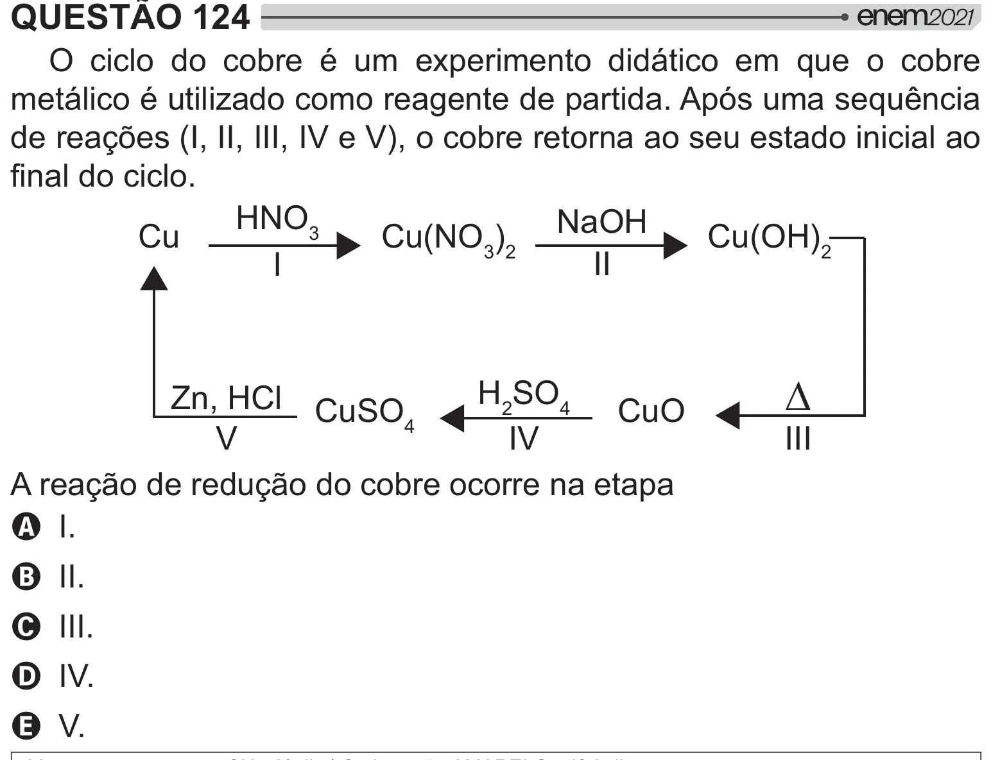

Texto extraído (pode conter ruído)

QUESTÃO 124  
O ciclo do cobre é um experimento didático em que o cobre  
metálico é utilizado como reagente de partida. Após uma sequência  
de reações (I, II, III, IV e V), o cobre retorna ao seu estado inicial ao  
!  
HNO 3  
Cu(NO 3 ) 2 NaOH  
Cu  
Cu(OH) 2  
I  
II  
H 2 SO 4  
¯  
Zn, HCl CuSO  
CuO  
4  
V  
IV  
III  
A reação de redução do cobre ocorre na etapa  
A I.  
B II.  
C III.  
D IV.  
E V.

