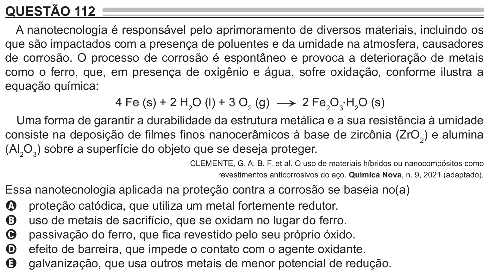

Texto extraído (pode conter ruído)

QUESTÃO 112  
A nanotecnologia é responsável pelo aprimoramento de diversos materiais, incluindo os  
que são impactados com a presença de poluentes e da umidade na atmosfera, causadores  
de corrosão. O processo de corrosão é espontâneo e provoca a deterioração de metais  
como o ferro, que, em presença de oxigênio e água, sofre oxidação, conforme ilustra a  
equação química:  
4 Fe (s) + 2 H 2 O (l) + 3 O 2 (g) → 2 Fe 2 O 3 ⋅ H 2 O (s)  
Uma forma de garantir a durabilidade da estrutura metálica e a sua resistência à umidade  
consiste na deposição de filmes finos nanocerâmicos à base de zircônia (ZrO 2 ) e alumina  
(Al 2 O 3 ) sobre a superfície do objeto que se deseja proteger.  
CLEMENTE, G. A. B. F. et al. O uso de materiais híbridos ou nanocompósitos como  
revestimentos anticorrosivos do aço. Química Nova, n. 9, 2021 (adaptado).  
Essa nanotecnologia aplicada na proteção contra a corrosão se baseia no(a)  
A proteção catódica, que utiliza um metal fortemente redutor.  
B uso de metais de sacrifício, que se oxidam no lugar do ferro.  
C passivação do ferro, que fica revestido pelo seu próprio óxido.  
D efeito de barreira, que impede o contato com o agente oxidante.  
E galvanização, que usa outros metais de menor potencial de redução.

