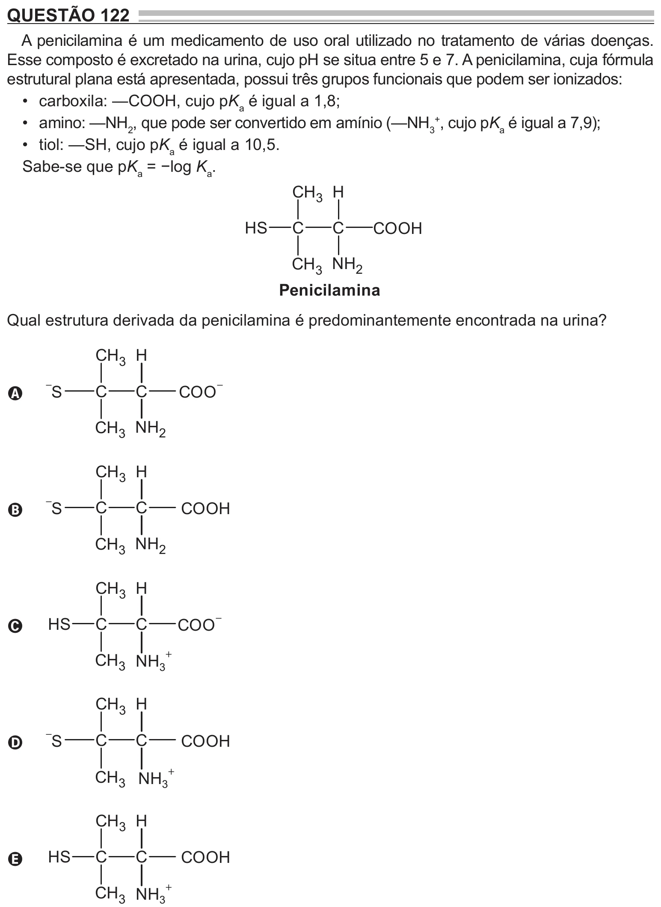

Texto extraído (pode conter ruído)

QUESTÃO 122  
A penicilamina é um medicamento de uso oral utilizado no tratamento de várias doenças.  
Esse composto é excretado na urina, cujo pH se situa entre 5 e 7. A penicilamina, cuja fórmula  
estrutural plana está apresentada, possui três grupos funcionais que podem ser ionizados:  
• carboxila: —COOH, cujo pK a é igual a 1,8;  
• amino: —NH 2 , que pode ser convertido em amínio (—NH 3 + , cujo pK a é igual a 7,9);  
• tiol: —SH, cujo pK a é igual a 10,5.  
Sabe-se que pK a = −log K a .  
CH 3 H  
H S  
C  
C  
COOH  
CH 3 NH 2  
Penicilamina  
Qual estrutura derivada da penicilamina é predominantemente encontrada na urina?  
CH 3 H  
−  
−  
S  
C  
C  
COO  
A  
CH 3 NH 2  
CH 3 H  
−  
C  
C  
S  
COOH  
B  
CH 3 NH 2  
CH 3 H  
−  
H S  
C  
C  
COO  
C  
+  
CH 3 NH 3  
CH 3 H  
−  
S  
C  
C  
COOH  
D  
CH 3 NH 3 +  
CH 3 H  
H S  
C  
C  
COOH  
E  
+  
CH 3 NH 3

