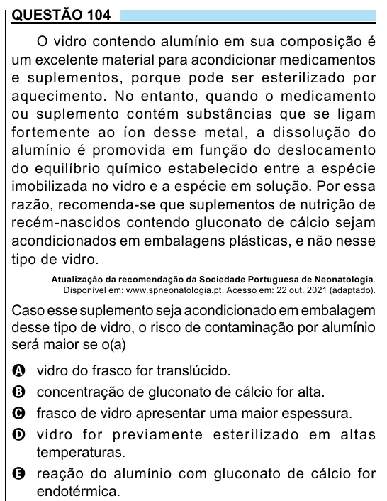

Texto extraído (pode conter ruído)

QUESTÃO 104  
O vidro contendo alumínio em sua composição é  
um excelente material para acondicionar medicamentos  
e suplementos, porque pode ser esterilizado por  
aquecimento. No entanto, quando o medicamento  
ou suplemento contém substâncias que se ligam  
for temente ao íon desse metal, a dissolução do  
alumínio é promovida em função do deslocamento  
do equilíbrio químico estabelecido entre a espécie  
imobilizada no vidro e a espécie em solução. Por essa  
razão, recomenda-se que suplementos de nutrição de  
recém-nascidos contendo gluconato de cálcio sejam  
acondicionados em embalagens plásticas, e não nesse  
tipo de vidro.  
Atualização da recomendação da Sociedade Portuguesa de Neonatologia.  
Disponível em: www.spneonatologia.pt. Acesso em: 22 out. 2021 (adaptado).  
Caso esse suplemento seja acondicionado em embalagem  
desse tipo de vidro, o risco de contaminação por alumínio  
será maior se o(a)  
vidro do frasco for translúcido.  
A  
B  
concentração de gluconato de cálcio for alta.  
frasco de vidro apresentar uma maior espessura.  
C  
vidro for previamente esterilizado em altas  
D  
temperaturas.  
E reação do alumínio com gluconato de cálcio for  
endotérmica.

