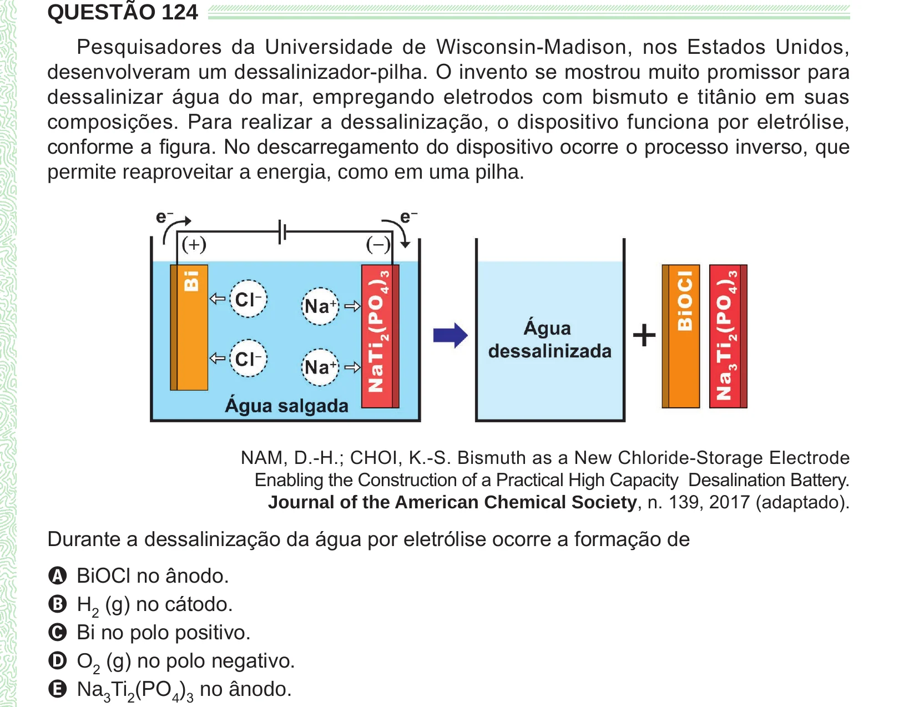

Texto extraído (pode conter ruído)

QUESTÃO 124  
Pesquisadores da Universidade de Wisconsin-Madison, nos Estados Unidos,  
desenvolveram um dessalinizador-pilha. O invento se mostrou muito promissor para  
dessalinizar água do mar, empregando eletrodos com bismuto e titânio em suas  
composições. Para realizar a dessalinização, o dispositivo funciona por eletrólise,  
conforme a figura. No descarregamento do dispositivo ocorre o processo inverso, que  
permite reaproveitar a energia, como em uma pilha.  
NAM, D.-H.; CHOI, K.-S. Bismuth as a New Chloride-Storage Electrode  
Enabling the Construction of a Practical High Capacity Desalination Battery.  
Journal of the American Chemical Society, n. 139, 2017 (adaptado).  
Durante a dessalinização da água por eletrólise ocorre a formação de  
A BiOCl no ânodo.  
B H 2 (g) no cátodo.  
C Bi no polo positivo.  
D O 2 (g) no polo negativo.  
E Na 3 Ti 2 (PO 4 ) 3 no ânodo.

