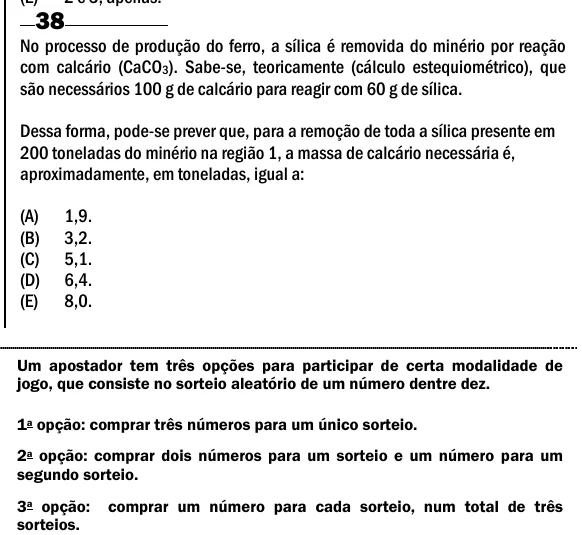

Texto extraído (pode conter ruído)

38  
No processo de produção do ferro, a sílica é removida do minério por reação  
com calcário (CaCO 3 ). Sabe-se, teoricamente (cálculo estequiométrico), que  
são necessários 100 g de calcário para reagir com 60 g de sílica.  
Dessa forma, pode-se prever que, para a remoção de toda a sílica presente em  
200 toneladas do minério na região 1, a massa de calcário necessária é,  
aproximadamente, em toneladas, igual a:  
(A)  
1,9.  
(B)  
3,2.  
(C)  
5,1.  
(D)  
6,4.  
(E)  
8,0.  
Um apostador tem três opções para participar de certa modalidade de  
jogo, que consiste no sorteio aleatório de um número dentre dez.  
1 a opção: comprar três números para um único sorteio.  
2 a opção: comprar dois números para um sorteio e um número para um  
segundo sorteio.  
3 a opção:  
comprar um número para cada sorteio, num total de três  
sorteios.

