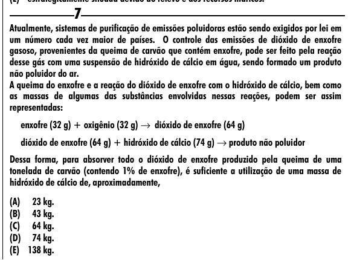

Texto extraído (pode conter ruído)

7  
Atualmente, sistemas de purificação de emissões poluidoras estão sendo exigidos por lei em  
um número cada vez maior de países. O controle das emissões de dióxido de enxofre  
gasoso, provenientes da queima de carvão que contém enxofre, pode ser feito pela reação  
desse gás com uma suspensão de hidróxido de cálcio em água, sendo formado um produto  
não poluidor do ar.  
A queima do enxofre e a reação do dióxido de enxofre com o hidróxido de cálcio, bem como  
as massas de algumas das substâncias envolvidas nessas reações, podem ser assim  
representadas:  
enxofre (32 g) + oxigênio (32 g) → dióxido de enxofre (64 g)  
dióxido de enxofre (64 g) + hidróxido de cálcio (74 g) → produto não poluidor  
Dessa forma, para absorver todo o dióxido de enxofre produzido pela queima de uma  
tonelada de carvão (contendo 1% de enxofre), é suficiente a utilização de uma massa de  
hidróxido de cálcio de, aproximadamente,  
(A) 23 kg.  
(B) 43 kg.  
(C) 64 kg.  
(D) 74 kg.  
(E) 138 kg.

