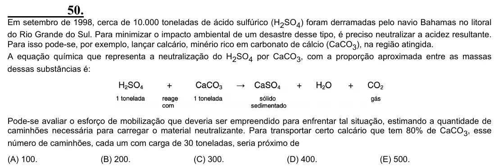

Texto extraído (pode conter ruído)

50.  
Em setembro de 1998, cerca de 10.000 toneladas de ácido sulfúrico (H 2 SO 4 ) foram derramadas pelo navio Bahamas no litoral  
do Rio Grande do Sul. Para minimizar o impacto ambiental de um desastre desse tipo, é preciso neutralizar a acidez resultante.  
Para isso pode-se, por exemplo, lançar calcário, minério rico em carbonato de cálcio (CaCO 3 ), na região atingida.  
A equação química que representa a neutralização do H 2 SO 4 por CaCO 3 , com a proporção aproximada entre as massas  
dessas substâncias é:  
Pode-se avaliar o esforço de mobilização que deveria ser empreendido para enfrentar tal situação, estimando a quantidade de  
caminhões necessária para carregar o material neutralizante. Para transportar certo calcário que tem 80% de CaCO 3 , esse  
número de caminhões, cada um com carga de 30 toneladas, seria próximo de  
(A) 100.  
(B) 200.  
(C) 300.  
(D) 400.  
(E) 500.

