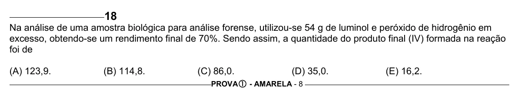

Texto extraído (pode conter ruído)

18  
Na análise de uma amostra biológica para análise forense, utilizou-se 54 g de luminol e peróxido de hidrogênio em  
excesso, obtendo-se um rendimento final de 70%. Sendo assim, a quantidade do produto final (IV) formada na reação  
foi de  
(A) 123,9.  
(B) 114,8.  
(C) 86,0.  
(D) 35,0.  
(E) 16,2.  
PROVA c - AMARELA - 8

