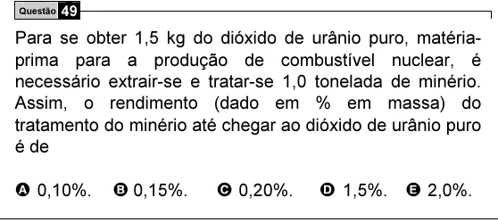

Texto extraído (pode conter ruído)

Questão 49  
Para se obter 1,5 kg do dióxido de urânio puro, matéria-  
prima para a produção de combustível nuclear, é  
necessário extrair-se e tratar-se 1,0 tonelada de minério.  
Assim, o rendimento (dado em % em massa) do  
tratamento do minério até chegar ao dióxido de urânio puro  
é de  
A 0,10%.  
B 0,15%.  
C 0,20%.  
D 1,5%. E 2,0%.

