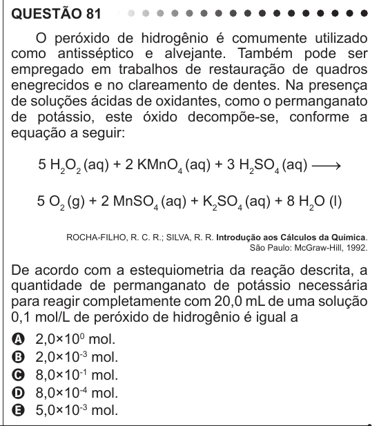

Texto extraído (pode conter ruído)

QUESTÃO 81  
O peróxido de hidrogênio é comumente utilizado  
como antisséptico e alvejante. Também pode ser  
empregado em trabalhos de restauração de quadros  
enegrecidos e no clareamento de dentes. Na presença  
de soluções ácidas de oxidantes, como o permanganato  
de potássio, este óxido decompõe-se, conforme a  
equação a seguir:  
5 H 2 O 2 (aq) + 2 KMnO 4 (aq) + 3 H 2 SO 4 (aq)  
5 O 2 (g) + 2 MnSO 4 (aq) + K 2 SO 4 (aq) + 8 H 2 O (l)  
ROCHA-FILHO, R. C. R.; SILVA, R. R. Introdução aos Cálculos da Química.  
São Paulo: McGraw-Hill, 1992.  
De acordo com a estequiometria da reação descrita, a  
quantidade de permanganato de potássio necessária  
para reagir completamente com 20,0 mL de uma solução  
0,1 mol/L de peróxido de hidrogênio é igual a  
2,0×10 0 mol.  
A  
2,0×10 -3 mol.  
B  
C  
8,0×10 -1 mol.  
D  
8,0×10 -4 mol.  
5,0×10 -3 mol.  
E

