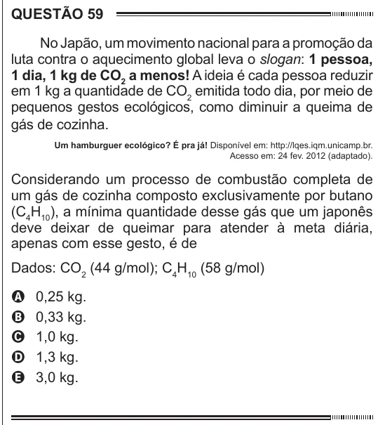

Texto extraído (pode conter ruído)

QUESTÃO 59  
No Japão, um movimento nacional para a promoção da  
luta contra o aquecimento global leva o slogan: 1 pessoa,  
1 dia, 1 kg de CO 2 a menos! A ideia é cada pessoa reduzir  
em 1 kg a quantidade de CO 2 emitida todo dia, por meio de  
pequenos gestos ecológicos, como diminuir a queima de  
gás de cozinha.  
Um hamburguer ecológico? É pra já! Disponível em: http://lqes.iqm.unicamp.br.  
Acesso em: 24 fev. 2012 (adaptado).  
Considerando um processo de combustão completa de  
um gás de cozinha composto exclusivamente por butano  
(C 4 H 10 ), a mínima quantidade desse gás que um japonês  
deve deixar de queimar para atender à meta diária,  
apenas com esse gesto, é de  
Dados: CO 2 (44 g/mol); C 4 H 10 (58 g/mol)  
A  
0,25 kg.  
0,33 kg.  
B  
C  
1,0 kg.  
1,3 kg.  
D  
3,0 kg.  
E

