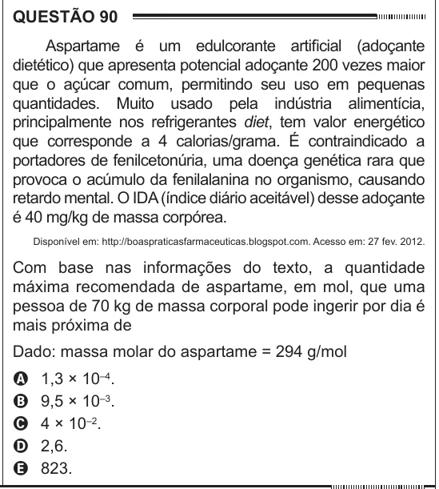

Texto extraído (pode conter ruído)

QUESTÃO 90  
Aspartame é um edulcorante artificial (adoçante  
dietético) que apresenta potencial adoçante 200 vezes maior  
que o açúcar comum, permitindo seu uso em pequenas  
quantidades. Muito usado pela indústria alimentícia,  
principalmente nos refrigerantes diet, tem valor energético  
que corresponde a 4 calorias/grama. É contraindicado a  
portadores de fenilcetonúria, uma doença genética rara que  
provoca o acúmulo da fenilalanina no organismo, causando  
retardo mental. O IDA (índice diário aceitável) desse adoçante  
é 40 mg/kg de massa corpórea.  
Disponível em: http://boaspraticasfarmaceuticas.blogspot.com. Acesso em: 27 fev. 2012.  
Com base nas informações do texto, a quantidade  
máxima recomendada de aspartame, em mol, que uma  
pessoa de 70 kg de massa corporal pode ingerir por dia é  
mais próxima de  
Dado: massa molar do aspartame = 294 g/mol  
1,3 × 10 –4 .  
A  
B  
9,5 × 10 –3 .  
4 × 10 –2 .  
C  
D  
2,6.  
823.  
E

