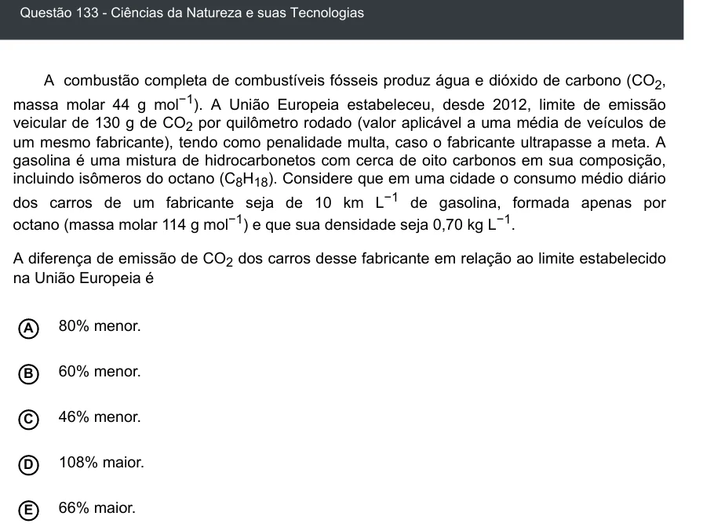

Texto extraído (pode conter ruído)

Questão 133 - Ciências da Natureza e suas Tecnologias  
A combustão completa de combustíveis fósseis produz água e dióxido de carbono (CO 2 ,  
massa molar 44 g mol −1 ). A União Europeia estabeleceu, desde 2012, limite de emissão  
veicular de 130 g de CO 2 por quilômetro rodado (valor aplicável a uma média de veículos de  
um mesmo fabricante), tendo como penalidade multa, caso o fabricante ultrapasse a meta. A  
gasolina é uma mistura de hidrocarbonetos com cerca de oito carbonos em sua composição,  
incluindo isômeros do octano (C 8 H 18 ). Considere que em uma cidade o consumo médio diário  
dos carros de um fabricante seja de 10 km L −1 de gasolina, formada apenas por  
octano (massa molar 114 g mol −1 ) e que sua densidade seja 0,70 kg L −1 .  
A diferença de emissão de CO 2 dos carros desse fabricante em relação ao limite estabelecido  
na União Europeia é  
80% menor.  
A  
60% menor.  
B  
46% menor.  
C  
D  
108% maior.  
66% maior.  
E

