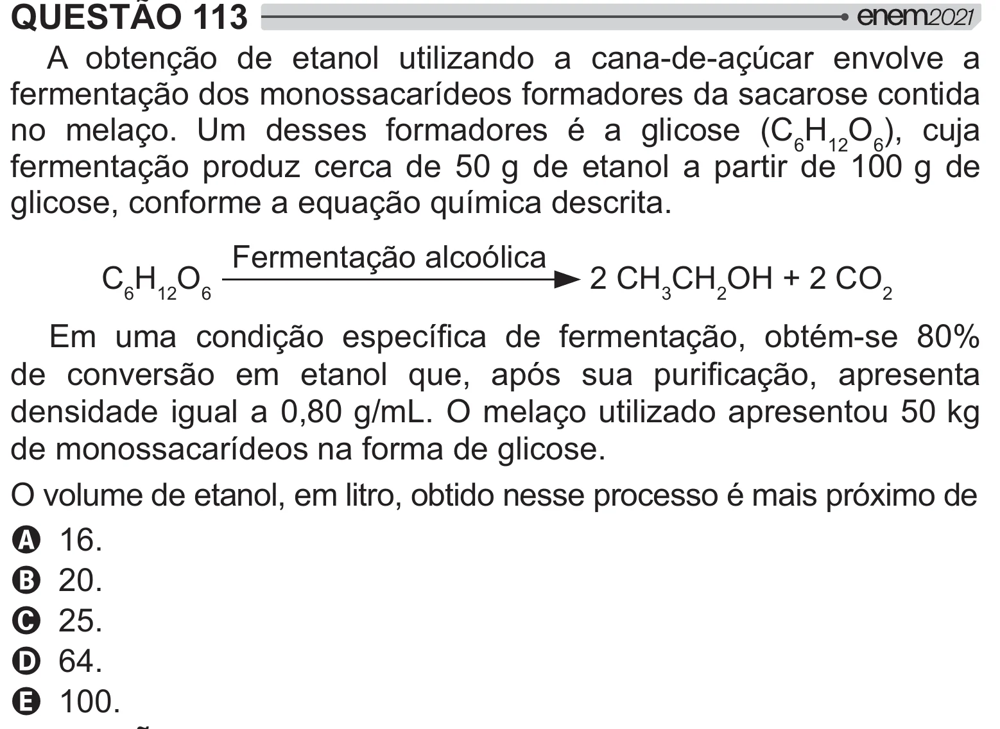

Texto extraído (pode conter ruído)

QUESTÃO 113  
A obtenção de etanol utilizando a cana-de-açúcar envolve a  
fermentação dos monossacarídeos formadores da sacarose contida  
no melaço. Um desses formadores é a glicose (C 6 H 12 O 6 ), cuja  
fermentação produz cerca de 50 g de etanol a partir de 100 g de  
glicose, conforme a equação química descrita.  
Fermentação alcoólica  
C 6 H 12 O 6  
2 CH 3 CH 2 OH + 2 CO 2  
  =[ # {   >   =[ y <  £_¤  
  "  [    
 #ƒ   # =[ #  
   
densidade igual a 0,80 g/mL. O melaço utilizado apresentou 50 kg  
de monossacarídeos na forma de glicose.  
O volume de etanol, em litro, obtido nesse processo é mais próximo de  
A 16.  
B 20.  
C 25.  
D 64.  
E 100.

