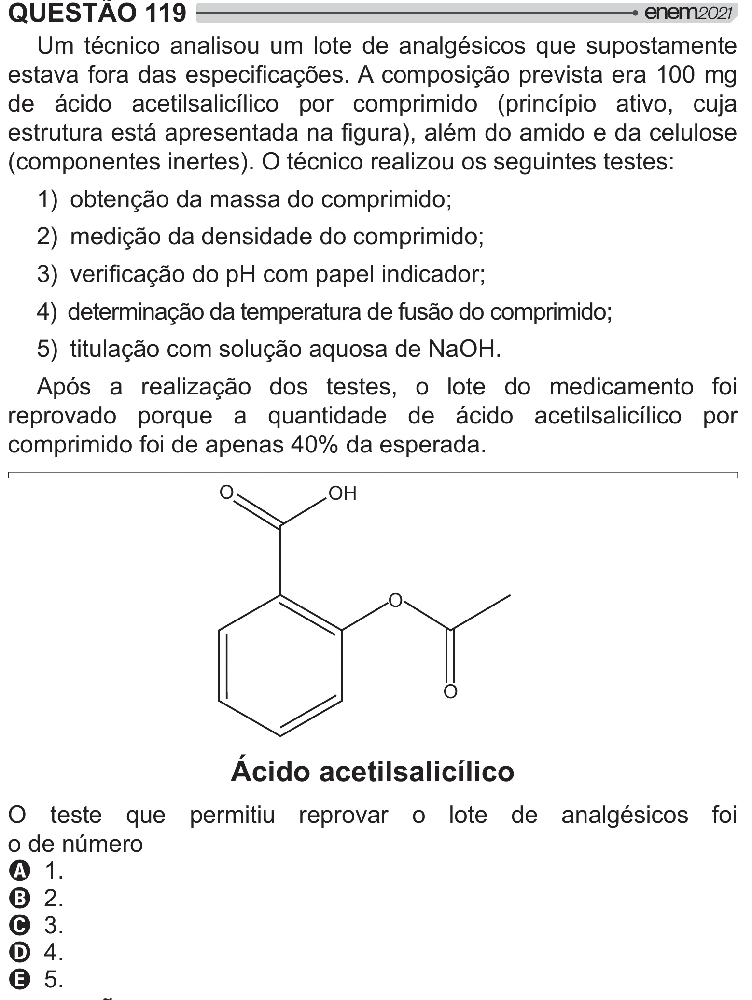

Texto extraído (pode conter ruído)

QUESTÃO 119  
Um técnico analisou um lote de analgésicos que supostamente  
">  # = !# =[# "  `__  
de ácido acetilsalicílico por comprimido (princípio ativo, cuja  
  /#  
  W<      
(componentes inertes). O técnico realizou os seguintes testes:  
1) obtenção da massa do comprimido;  
2) medição da densidade do comprimido;  
®W " =[#’## ˜  
4) determinação da temperatura de fusão do comprimido;  
5) titulação com solução aquosa de NaOH.  
Após a realização dos testes, o lote do medicamento foi  
reprovado porque a quantidade de ácido acetilsalicílico por  
comprimido foi de apenas 40% da esperada.  
O  
OH  
O  
O  
Ácido acetilsalicílico  
O teste que permitiu reprovar o lote de analgésicos foi  
o de número  
A 1.  
B 2.  
C 3.  
D 4.  
E 5.

