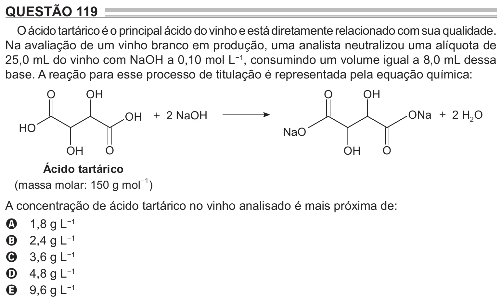

Texto extraído (pode conter ruído)

QUESTÃO 119  
O ácido tartárico é o principal ácido do vinho e está diretamente relacionado com sua qualidade.  
Na avaliação de um vinho branco em produção, uma analista neutralizou uma alíquota de  
25,0 mL do vinho com NaOH a 0,10 mol L −1 , consumindo um volume igual a 8,0 mL dessa  
base. A reação para esse processo de titulação é representada pela equação química:  
O  
OH  
O  
OH  
ONa  2 H 2 O  
OH  
 2 NaOH  
H O  
NaO  
OH  
O  
OH  
O  
Ácido tartárico  
 1  
(massa molar: 150 g mol )  
A concentração de ácido tartárico no vinho analisado é mais próxima de:  
1,8 g L −1  
A  
2,4 g L −1  
B  
3,6 g L −1  
C  
4,8 g L −1  
D  
9,6 g L −1  
E

