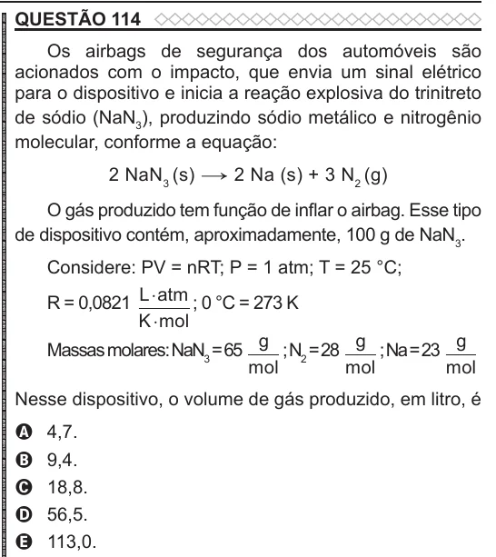

Texto extraído (pode conter ruído)

QUESTÃO 114  
Os airbags de segurança dos automóveis são  
acionados com o impacto, que envia um sinal elétrico  
para o dispositivo e inicia a reação explosiva do trinitreto  
de sódio (NaN 3 ), produzindo sódio metálico e nitrogênio  
molecular, conforme a equação:  
2 NaN 3 (s) → 2 Na (s) + 3 N 2 (g)  
O gás produzido tem função de inflar o airbag. Esse tipo  
de dispositivo contém, aproximadamente, 100 g de NaN 3 .  
Considere: PV = nRT; P = 1 atm; T = 25 °C;  
R = 0,0821 L ⋅ atm ; 0 °C = 273 K  
K ⋅ mol  
g  
g  
g  
Massas molares: NaN 3 = 65  
; N 2 = 28  
; Na = 23  
mol  
mol  
mol  
Nesse dispositivo, o volume de gás produzido, em litro, é  
4,7.  
A  
9,4.  
B  
18,8.  
C  
56,5.  
D  
113,0.  
E

