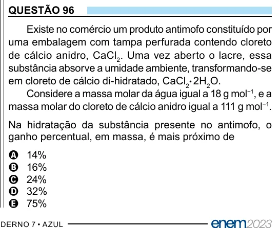

Texto extraído (pode conter ruído)

QUESTÃO 96  
Existe no comércio um produto antimofo constituído por  
uma embalagem com tampa perfurada contendo cloreto  
de cálcio anidro, CaCl 2 . Uma vez aberto o lacre, essa  
substância absorve a umidade ambiente, transformando-se  
em cloreto de cálcio di-hidratado, CaCl 2 ⋅ 2H 2 O.  
Considere a massa molar da água igual a 18 g mol −1 , e a  
massa molar do cloreto de cálcio anidro igual a 111 g mol −1 .  
Na hidratação da substância presente no antimofo, o  
ganho percentual, em massa, é mais próximo de  
14%  
A  
B  
16%  
24%  
C  
32%  
D  
75%  
E

