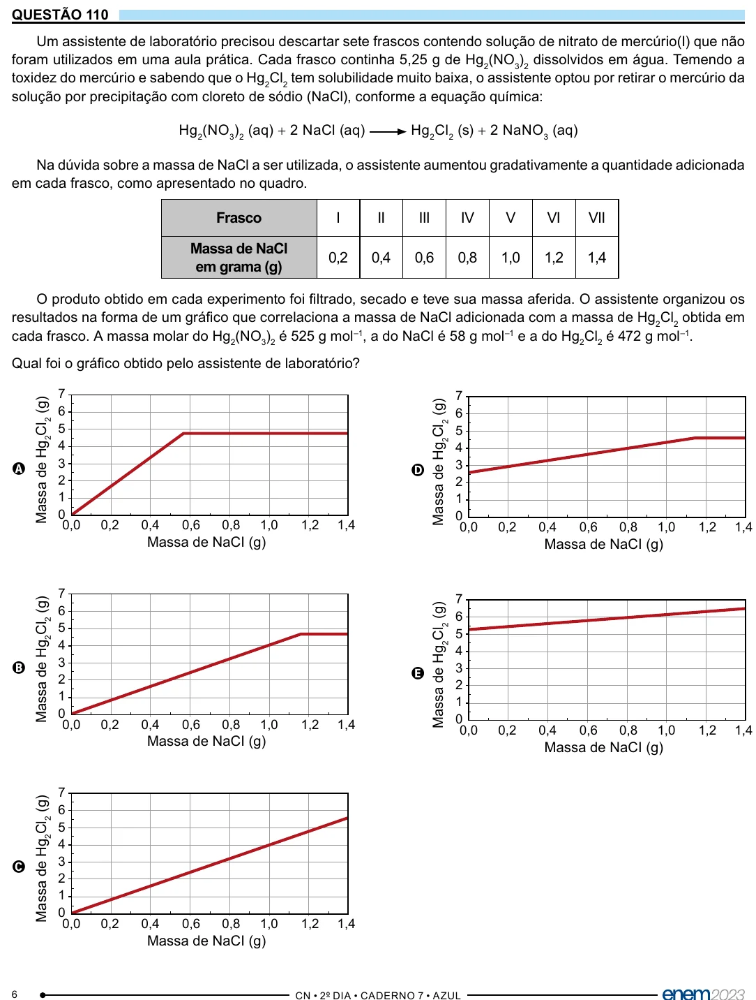

Texto extraído (pode conter ruído)

QUESTÃO 110  
Um assistente de laboratório precisou descartar sete frascos contendo solução de nitrato de mercúrio(I) que não  
foram utilizados em uma aula prática. Cada frasco continha 5,25 g de Hg 2 (NO 3 ) 2 dissolvidos em água. Temendo a  
toxidez do mercúrio e sabendo que o Hg 2 Cl 2 tem solubilidade muito baixa, o assistente optou por retirar o mercúrio da  
solução por precipitação com cloreto de sódio (NaCl), conforme a equação química:  
Hg 2 (NO 3 ) 2 (aq) + 2 NaCl (aq)  
Hg 2 Cl 2 (s) + 2 NaNO 3 (aq)  
Na dúvida sobre a massa de NaCl a ser utilizada, o assistente aumentou gradativamente a quantidade adicionada  
em cada frasco, como apresentado no quadro.  
Frasco  
I  
II  
III  
IV  
V  
VI  
VII  
Massa de NaCl  
0,2  
0,4  
0,6  
0,8  
1,0  
1,2  
1,4  
em grama (g)  
O produto obtido em cada experimento foi filtrado, secado e teve sua massa aferida. O assistente organizou os  
resultados na forma de um gráfico que correlaciona a massa de NaCl adicionada com a massa de Hg 2 Cl 2 obtida em  
cada frasco. A massa molar do Hg 2 (NO 3 ) 2 é 525 g mol –1 , a do NaCl é 58 g mol –1 e a do Hg 2 Cl 2 é 472 g mol –1 .  
Qual foi o gráfico obtido pelo assistente de laboratório?  
7  
7  
Massa de Hg 2 Cl 2 (g)  
Massa de Hg 2 Cl 2 (g)  
6  
6  
5  
5  
4  
4  
3  
3  
A  
D  
2  
2  
1  
1  
0  
0  
0,0  
0,2  
0,4  
0,6  
0,8  
1,0  
1,2  
1,4  
0,0  
0,2  
0,4  
0,6  
0,8  
1,0  
1,2  
1,4  
Massa de NaCI (g)  
Massa de NaCI (g)  
7  
7  
Massa de Hg 2 Cl 2 (g)  
6  
Massa de Hg 2 Cl 2 (g)  
6  
5  
5  
4  
4  
3  
B  
3  
E  
2  
2  
1  
1  
0  
0  
0,0  
0,2  
0,4  
0,6  
0,8  
1,0  
1,2  
1,4  
0,0  
0,2  
0,4  
0,6  
0,8  
1,0  
1,2  
1,4  
Massa de NaCI (g)  
Massa de NaCI (g)  
7  
Massa de Hg 2 Cl 2 (g)  
6  
5  
4  
3  
C  
2  
1  
0  
0,0  
0,2  
0,4  
0,6  
0,8  
1,0  
1,2  
1,4  
Massa de NaCI (g)  
6

