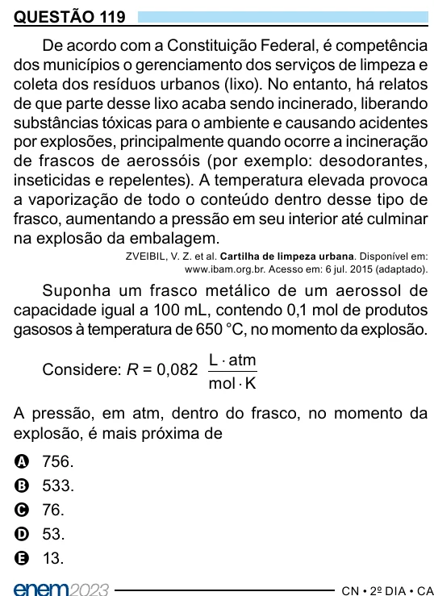

Texto extraído (pode conter ruído)

QUESTÃO 119  
De acordo com a Constituição Federal, é competência  
dos municípios o gerenciamento dos serviços de limpeza e  
coleta dos resíduos urbanos (lixo). No entanto, há relatos  
de que parte desse lixo acaba sendo incinerado, liberando  
substâncias tóxicas para o ambiente e causando acidentes  
por explosões, principalmente quando ocorre a incineração  
de frascos de aerossóis (por exemplo: desodorantes,  
inseticidas e repelentes). A temperatura elevada provoca  
a vaporização de todo o conteúdo dentro desse tipo de  
frasco, aumentando a pressão em seu interior até culminar  
na explosão da embalagem.  
ZVEIBIL, V. Z. et al. Cartilha de limpeza urbana. Disponível em:  
www.ibam.org.br. Acesso em: 6 jul. 2015 (adaptado).  
Suponha um frasco metálico de um aerossol de  
capacidade igual a 100 mL, contendo 0,1 mol de produtos  
gasosos à temperatura de 650 °C, no momento da explosão.  
L ⋅ atm  
Considere: R = 0,082  
mol ⋅ K  
A pressão, em atm, dentro do frasco, no momento da  
explosão, é mais próxima de  
756.  
A  
B  
533.  
76.  
C  
53.  
D  
13.  
E

