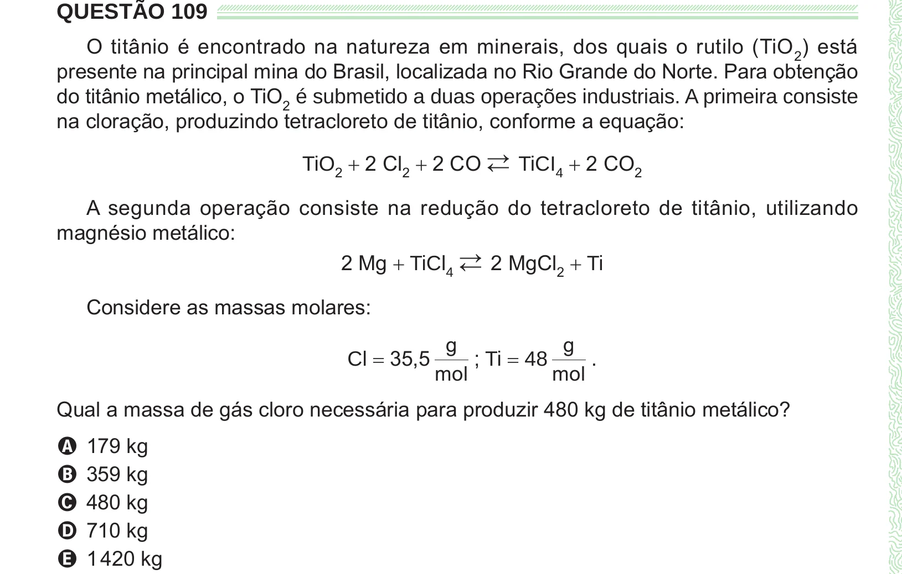

Texto extraído (pode conter ruído)

QUESTÃO 109  
O titânio é encontrado na natureza em minerais, dos quais o rutilo (TiO 2 ) está  
presente na principal mina do Brasil, localizada no Rio Grande do Norte. Para obtenção  
do titânio metálico, o TiO 2 é submetido a duas operações industriais. A primeira consiste  
na cloração, produzindo tetracloreto de titânio, conforme a equação:  
TiO 2 + 2 Cl 2 + 2 CO →  
← TiCI 4 + 2 CO 2  
A segunda operação consiste na redução do tetracloreto de titânio, utilizando  
magnésio metálico:  
2 Mg + TiCl 4 →  
← 2 MgCl 2 + Ti  
Considere as massas molares:  
g  
g  
Cl = 35,5  
; Ti = 48  
.  
mol  
mol  
Qual a massa de gás cloro necessária para produzir 480 kg de titânio metálico?  
A 179 kg  
B 359 kg  
C 480 kg  
D 710 kg  
E 1 420 kg

