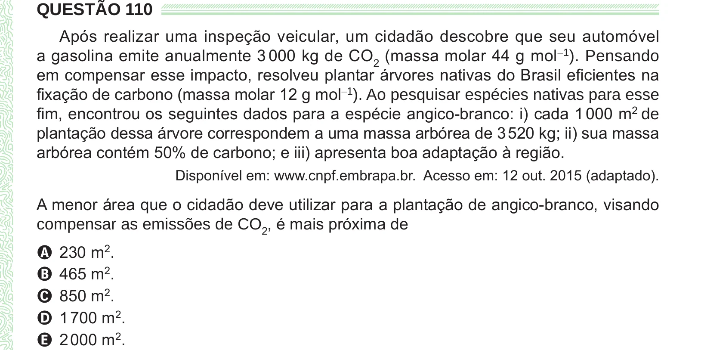

Texto extraído (pode conter ruído)

QUESTÃO 110  
Após realizar uma inspeção veicular, um cidadão descobre que seu automóvel  
a gasolina emite anualmente 3 000 kg de CO 2 (massa molar 44 g mol −1 ). Pensando  
em compensar esse impacto, resolveu plantar árvores nativas do Brasil eficientes na  
fixação de carbono (massa molar 12 g mol −1 ). Ao pesquisar espécies nativas para esse  
fim, encontrou os seguintes dados para a espécie angico-branco: i) cada 1 000 m 2 de  
plantação dessa árvore correspondem a uma massa arbórea de 3 520 kg; ii) sua massa  
arbórea contém 50% de carbono; e iii) apresenta boa adaptação à região.  
Disponível em: www.cnpf.embrapa.br. Acesso em: 12 out. 2015 (adaptado).  
A menor área que o cidadão deve utilizar para a plantação de angico-branco, visando  
compensar as emissões de CO 2 , é mais próxima de  
A 230 m 2 .  
B 465 m 2 .  
C 850 m 2 .  
D 1 700 m 2 .  
E 2 000 m 2 .

