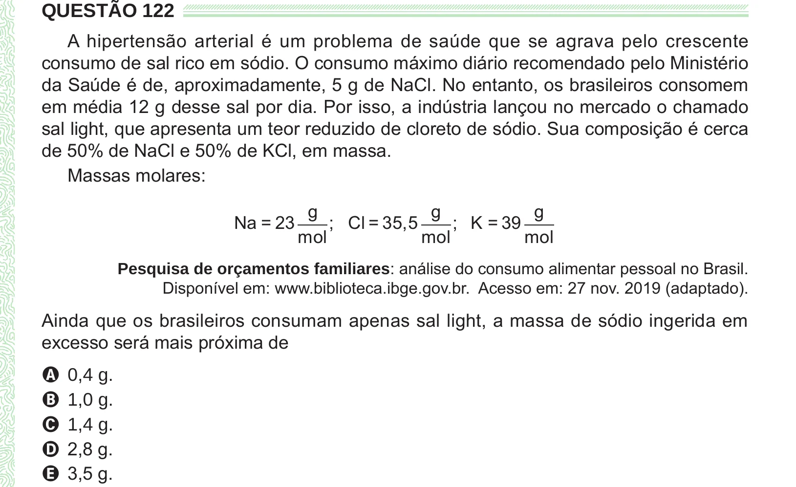

Texto extraído (pode conter ruído)

QUESTÃO 122  
A hipertensão arterial é um problema de saúde que se agrava pelo crescente  
consumo de sal rico em sódio. O consumo máximo diário recomendado pelo Ministério  
da Saúde é de, aproximadamente, 5 g de NaCl. No entanto, os brasileiros consomem  
em média 12 g desse sal por dia. Por isso, a indústria lançou no mercado o chamado  
sal light, que apresenta um teor reduzido de cloreto de sódio. Sua composição é cerca  
de 50% de NaCl e 50% de KCl, em massa.  
Massas molares:  
g  
g  
g  
Na = 23  
; Cl = 35,5  
; K = 39  
mol  
mol  
mol  
Pesquisa de orçamentos familiares: análise do consumo alimentar pessoal no Brasil.  
Disponível em: www.biblioteca.ibge.gov.br. Acesso em: 27 nov. 2019 (adaptado).  
Ainda que os brasileiros consumam apenas sal light, a massa de sódio ingerida em  
excesso será mais próxima de  
A 0,4 g.  
B 1,0 g.  
C 1,4 g.  
D 2,8 g.  
E 3,5 g.

