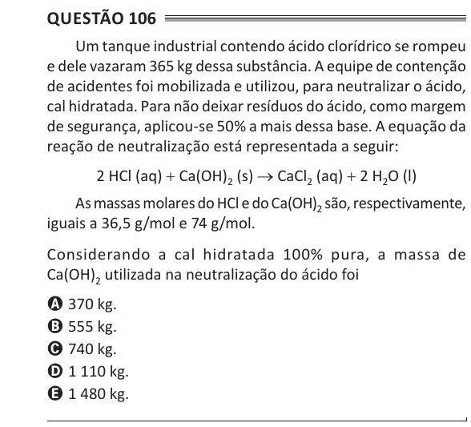

Texto extraído (pode conter ruído)

Questão 106  
Um tanque industrial contendo ácido clorídrico se rompeu  
e dele vazaram 365 kg dessa substância. A equipe de contenção  
de acidentes foi mobilizada e utilizou, para neutralizar o ácido,  
cal hidratada. Para não deixar resíduos do ácido, como margem  
de segurança, aplicou-se 50% a mais dessa base. A equação da  
reação de neutralização está representada a seguir:  
2 HCl (aq) + Ca(OH) 2 (s) → CaCl 2 (aq) + 2 H 2 O (l)  
As massas molares do HCl e do Ca(OH) 2 são, respectivamente,  
iguais a 36,5 g/mol e 74 g/mol.  
Considerando a cal hidratada 100% pura, a massa de  
Ca(OH) 2 utilizada na neutralização do ácido foi  
A 370 kg.  
B 555 kg.  
C 740 kg.  
D 1 110 kg.  
E 1 480 kg.

