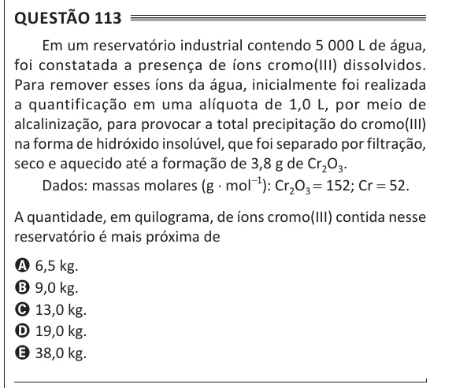

Texto extraído (pode conter ruído)

Questão 113  
Em um reservatório industrial contendo 5 000 L de água,  
foi constatada a presença de íons cromo(III) dissolvidos.  
Para remover esses íons da água, inicialmente foi realizada  
a quantificação em uma alíquota de 1,0 L, por meio de  
alcalinização, para provocar a total precipitação do cromo(III)  
na forma de hidróxido insolúvel, que foi separado por filtração,  
seco e aquecido até a formação de 3,8 g de Cr 2 O 3 .  
Dados: massas molares (g ⋅ mol −1 ): Cr 2 O 3 = 152; Cr = 52.  
A quantidade, em quilograma, de íons cromo(III) contida nesse  
reservatório é mais próxima de  
A 6,5 kg.  
B 9,0 kg.  
C 13,0 kg.  
D 19,0 kg.  
E 38,0 kg.

