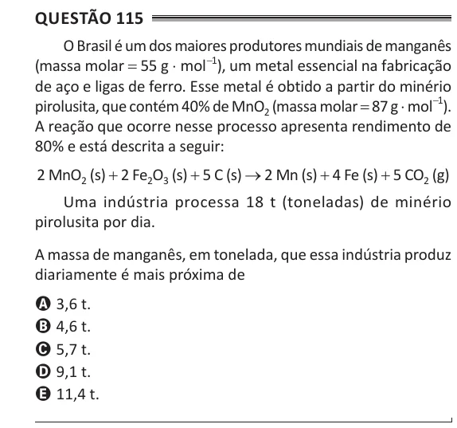

Texto extraído (pode conter ruído)

Questão 115  
O Brasil é um dos maiores produtores mundiais de manganês  
(massa molar = 55 g ⋅ mol -1 ), um metal essencial na fabricação  
de aço e ligas de ferro. Esse metal é obtido a partir do minério  
pirolusita, que contém 40% de MnO 2 (massa molar = 87 g ⋅ mol -1 ).  
A reação que ocorre nesse processo apresenta rendimento de  
80% e está descrita a seguir:  
2 MnO 2 (s) + 2 Fe 2 O 3 (s) + 5 C (s) → 2 Mn (s) + 4 Fe (s) + 5 CO 2 (g)  
Uma indústria processa 18 t (toneladas) de minério  
pirolusita por dia.  
A massa de manganês, em tonelada, que essa indústria produz  
diariamente é mais próxima de  
A 3,6 t.  
B 4,6 t.  
C 5,7 t.  
D 9,1 t.  
E 11,4 t.

