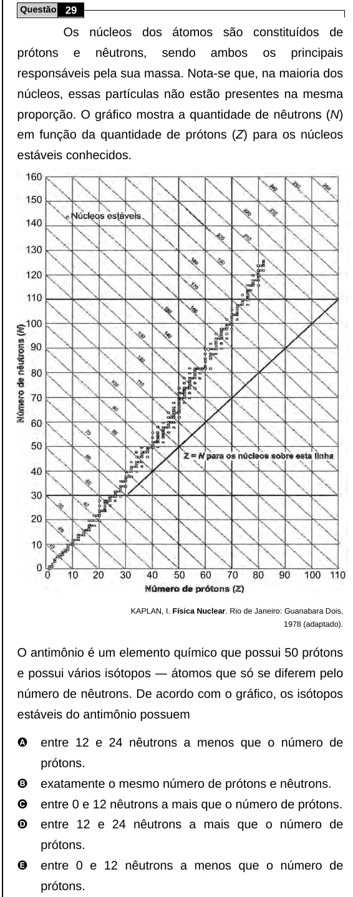

Texto extraído (pode conter ruído)

Questão 29  
Os núcleos dos átomos são constituídos de  
prótons  
e  
nêutrons,  
sendo  
ambos  
os  
principais  
responsáveis pela sua massa. Nota-se que, na maioria dos  
núcleos, essas partículas não estão presentes na mesma  
proporção. O gráfico mostra a quantidade de nêutrons (N)  
em função da quantidade de prótons (Z) para os núcleos  
estáveis conhecidos.  
KAPLAN, I. Física Nuclear. Rio de Janeiro: Guanabara Dois,  
1978 (adaptado).  
O antimônio é um elemento químico que possui 50 prótons  
e possui vários isótopos ― átomos que só se diferem pelo  
número de nêutrons. De acordo com o gráfico, os isótopos  
estáveis do antimônio possuem  
A  
entre 12 e 24 nêutrons a menos que o número de  
prótons.  
B  
exatamente o mesmo número de prótons e nêutrons.  
C  
entre 0 e 12 nêutrons a mais que o número de prótons.  
D  
entre 12 e 24 nêutrons a mais que o número de  
prótons.  
E  
entre 0 e 12 nêutrons a menos que o número de  
prótons.

