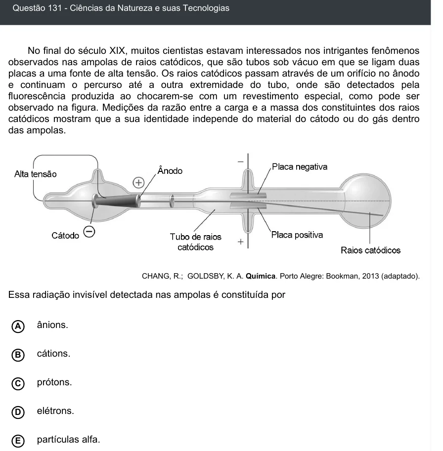

Texto extraído (pode conter ruído)

Questão 131 - Ciências da Natureza e suas Tecnologias  
No final do século XIX, muitos cientistas estavam interessados nos intrigantes fenômenos  
observados nas ampolas de raios catódicos, que são tubos sob vácuo em que se ligam duas  
placas a uma fonte de alta tensão. Os raios catódicos passam através de um orifício no ânodo  
e continuam o percurso até a outra extremidade do tubo, onde são detectados pela  
fluorescência produzida ao chocarem-se com um revestimento especial, como pode ser  
observado na figura. Medições da razão entre a carga e a massa dos constituintes dos raios  
catódicos mostram que a sua identidade independe do material do cátodo ou do gás dentro  
das ampolas.  
CHANG, R.; GOLDSBY, K. A. Química. Porto Alegre: Bookman, 2013 (adaptado).  
Essa radiação invisível detectada nas ampolas é constituída por  
A  
ânions.  
cátions.  
B  
prótons.  
C  
elétrons.  
D  
E  
partículas alfa.

