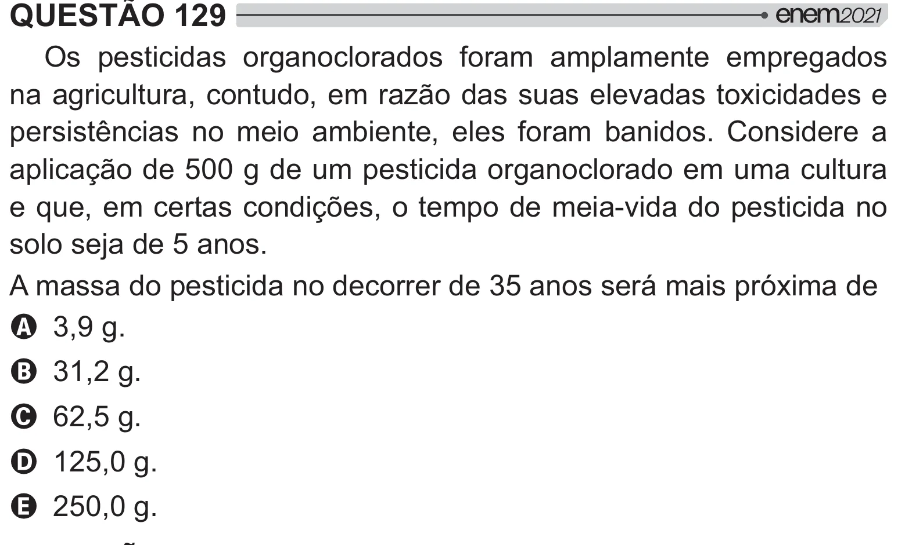

Texto extraído (pode conter ruído)

QUESTÃO 129  
Os pesticidas organoclorados foram amplamente empregados  
na agricultura, contudo, em razão das suas elevadas toxicidades e  
persistências no meio ambiente, eles foram banidos. Considere a  
aplicação de 500 g de um pesticida organoclorado em uma cultura  
e que, em certas condições, o tempo de meia-vida do pesticida no  
solo seja de 5 anos.  
A massa do pesticida no decorrer de 35 anos será mais próxima de  
A 3,9 g.  
B 31,2 g.  
C 62,5 g.  
D 125,0 g.  
E 250,0 g.

