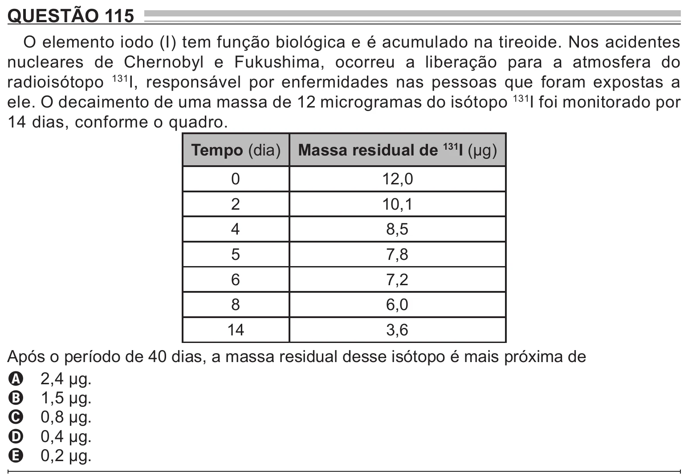

Texto extraído (pode conter ruído)

QUESTÃO 115  
O elemento iodo (I) tem função biológica e é acumulado na tireoide. Nos acidentes  
nucleares de Chernobyl e Fukushima, ocorreu a liberação para a atmosfera do  
radioisótopo 131 I, responsável por enfermidades nas pessoas que foram expostas a  
ele. O decaimento de uma massa de 12 microgramas do isótopo 131 I foi monitorado por  
14 dias, conforme o quadro.  
Tempo (dia)  
Massa residual de 131 I (µg)  
0  
12,0  
2  
10,1  
4  
8,5  
5  
7,8  
6  
7,2  
8  
6,0  
14  
3,6  
Após o período de 40 dias, a massa residual desse isótopo é mais próxima de  
A 2,4 µg.  
B 1,5 µg.  
C 0,8 µg.  
D 0,4 µg.  
E 0,2 µg.

