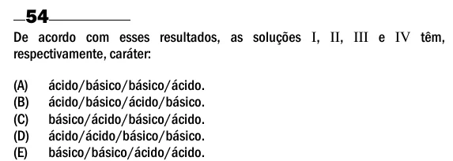

Texto extraído (pode conter ruído)

54  
De acordo com esses resultados, as soluções I, II, III e IV têm,  
respectivamente, caráter:  
(A)  
ácido/básico/básico/ácido.  
(B)  
ácido/básico/ácido/básico.  
(C)  
básico/ácido/básico/ácido.  
(D)  
ácido/ácido/básico/básico.  
(E)  
básico/básico/ácido/ácido.

