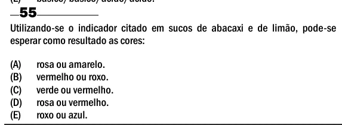

Texto extraído (pode conter ruído)

55  
Utilizando-se o indicador citado em sucos de abacaxi e de limão, pode-se  
esperar como resultado as cores:  
(A)  
rosa ou amarelo.  
(B)  
vermelho ou roxo.  
(C)  
verde ou vermelho.  
(D)  
rosa ou vermelho.  
(E)  
roxo ou azul.

