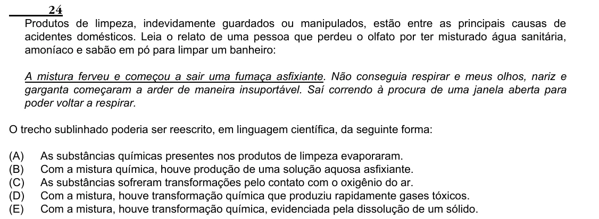

Texto extraído (pode conter ruído)

24  
Produtos de limpeza, indevidamente guardados ou manipulados, estão entre as principais causas de  
acidentes domésticos. Leia o relato de uma pessoa que perdeu o olfato por ter misturado água sanitária,  
amoníaco e sabão em pó para limpar um banheiro:  
A mistura ferveu e começou a sair uma fumaça asfixiante. Não conseguia respirar e meus olhos, nariz e  
garganta começaram a arder de maneira insuportável. Saí correndo à procura de uma janela aberta para  
poder voltar a respirar.  
O trecho sublinhado poderia ser reescrito, em linguagem científica, da seguinte forma:  
(A)  
As substâncias químicas presentes nos produtos de limpeza evaporaram.  
(B)  
Com a mistura química, houve produção de uma solução aquosa asfixiante.  
(C)  
As substâncias sofreram transformações pelo contato com o oxigênio do ar.  
(D)  
Com a mistura, houve transformação química que produziu rapidamente gases tóxicos.  
(E)  
Com a mistura, houve transformação química, evidenciada pela dissolução de um sólido.

