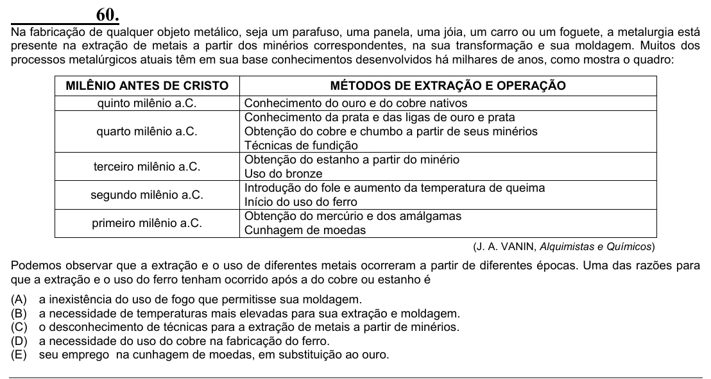

Texto extraído (pode conter ruído)

60.  
Na fabricação de qualquer objeto metálico, seja um parafuso, uma panela, uma jóia, um carro ou um foguete, a metalurgia está  
presente na extração de metais a partir dos minérios correspondentes, na sua transformação e sua moldagem. Muitos dos  
processos metalúrgicos atuais têm em sua base conhecimentos desenvolvidos há milhares de anos, como mostra o quadro:  
MILÊNIO ANTES DE CRISTO  
MÉTODOS DE EXTRAÇÃO E OPERAÇÃO  
quinto milênio a.C.  
Conhecimento do ouro e do cobre nativos  
Conhecimento da prata e das ligas de ouro e prata  
quarto milênio a.C.  
Obtenção do cobre e chumbo a partir de seus minérios  
Técnicas de fundição  
Obtenção do estanho a partir do minério  
terceiro milênio a.C.  
Uso do bronze  
Introdução do fole e aumento da temperatura de queima  
segundo milênio a.C.  
Início do uso do ferro  
Obtenção do mercúrio e dos amálgamas  
primeiro milênio a.C.  
Cunhagem de moedas  
(J. A. VANIN, Alquimistas e Químicos)  
Podemos observar que a extração e o uso de diferentes metais ocorreram a partir de diferentes épocas. Uma das razões para  
que a extração e o uso do ferro tenham ocorrido após a do cobre ou estanho é  
(A)  
a inexistência do uso de fogo que permitisse sua moldagem.  
(B)  
a necessidade de temperaturas mais elevadas para sua extração e moldagem.  
(C)  
o desconhecimento de técnicas para a extração de metais a partir de minérios.  
(D)  
a necessidade do uso do cobre na fabricação do ferro.  
(E)  
seu emprego na cunhagem de moedas, em substituição ao ouro.

