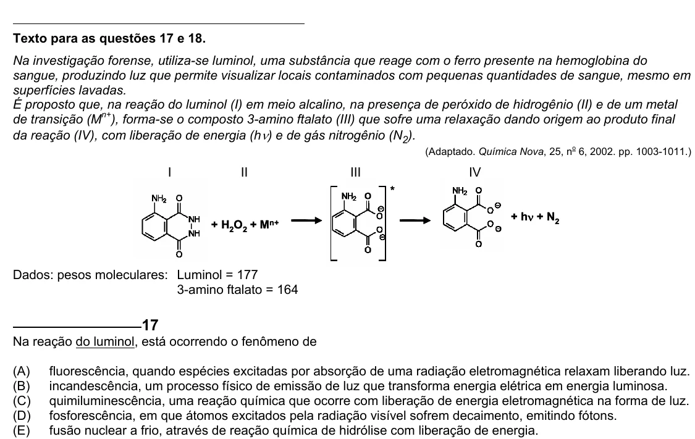

Texto extraído (pode conter ruído)

Texto para as questões 17 e 18.  
Na investigação forense, utiliza-se luminol, uma substância que reage com o ferro presente na hemoglobina do  
sangue, produzindo luz que permite visualizar locais contaminados com pequenas quantidades de sangue, mesmo em  
superfícies lavadas.  
É proposto que, na reação do luminol (I) em meio alcalino, na presença de peróxido de hidrogênio (II) e de um metal  
de transição (M n+ ), forma-se o composto 3-amino ftalato (III) que sofre uma relaxação dando origem ao produto final  
da reação (IV), com liberação de energia (h ν ) e de gás nitrogênio (N 2 ).  
o  
(Adaptado. Química Nova, 25, n 6, 2002. pp. 1003-1011.)  
I  
II  
III  
IV  
*  
+ hν + N 2  
+ H 2 O 2 + M n+  
Dados: pesos moleculares: Luminol = 177  
3-amino ftalato = 164  
17  
Na reação do luminol, está ocorrendo o fenômeno de  
(A)  
fluorescência, quando espécies excitadas por absorção de uma radiação eletromagnética relaxam liberando luz.  
(B)  
incandescência, um processo físico de emissão de luz que transforma energia elétrica em energia luminosa.  
(C)  
quimiluminescência, uma reação química que ocorre com liberação de energia eletromagnética na forma de luz.  
(D)  
fosforescência, em que átomos excitados pela radiação visível sofrem decaimento, emitindo fótons.  
(E)  
fusão nuclear a frio, através de reação química de hidrólise com liberação de energia.

