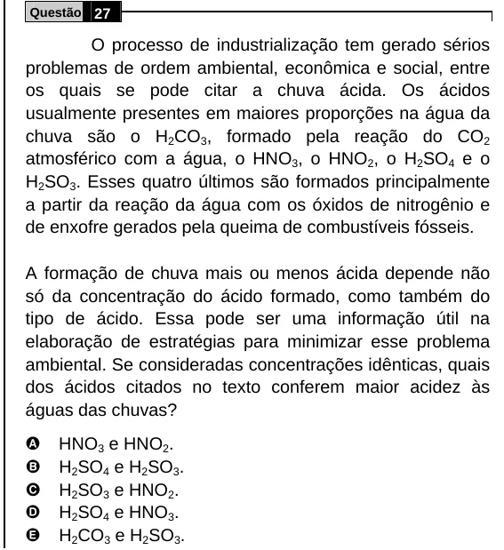

Texto extraído (pode conter ruído)

Questão 27  
O processo de industrialização tem gerado sérios  
problemas de ordem ambiental, econômica e social, entre  
os quais se pode citar a chuva ácida. Os ácidos  
usualmente presentes em maiores proporções na água da  
chuva são o H 2 CO 3 , formado pela reação do CO 2  
atmosférico com a água, o HNO 3 , o HNO 2 , o H 2 SO 4 e o  
H 2 SO 3 . Esses quatro últimos são formados principalmente  
a partir da reação da água com os óxidos de nitrogênio e  
de enxofre gerados pela queima de combustíveis fósseis.  
A formação de chuva mais ou menos ácida depende não  
só da concentração do ácido formado, como também do  
tipo de ácido. Essa pode ser uma informação útil na  
elaboração de estratégias para minimizar esse problema  
ambiental. Se consideradas concentrações idênticas, quais  
dos ácidos citados no texto conferem maior acidez às  
águas das chuvas?  
A  
HNO 3 e HNO 2 .  
B  
H 2 SO 4 e H 2 SO 3 .  
C  
H 2 SO 3 e HNO 2 .  
D  
H 2 SO 4 e HNO 3 .  
E  
H 2 CO 3 e H 2 SO 3 .

