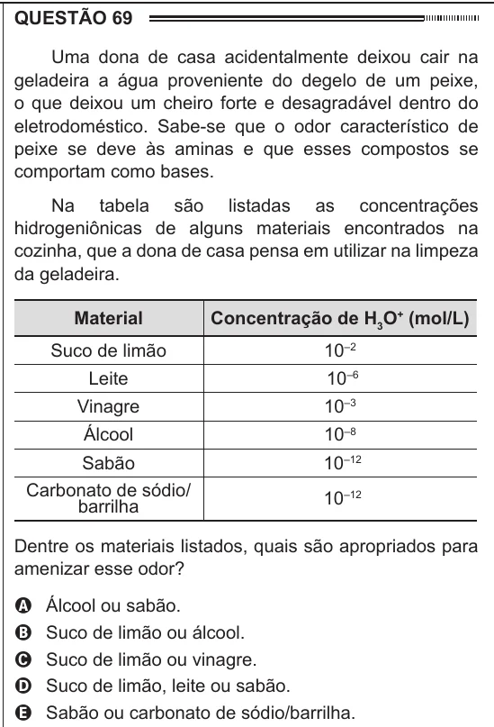

Texto extraído (pode conter ruído)

QUESTÃO 69  
Uma dona de casa acidentalmente deixou cair na  
geladeira a água proveniente do degelo de um peixe,  
o que deixou um cheiro forte e desagradável dentro do  
eletrodoméstico. Sabe-se que o odor característico de  
peixe se deve às aminas e que esses compostos se  
comportam como bases.  
Na tabela são listadas as concentrações  
hidrogeniônicas de alguns materiais encontrados na  
cozinha, que a dona de casa pensa em utilizar na limpeza  
da geladeira.  
Material  
Concentração de H 3 O + (mol/L)  
Suco de limão  
10 –2  
Leite  
10 –6  
Vinagre  
10 –3  
Álcool  
10 –8  
Sabão  
10 –12  
Carbonato de sódio/  
10 –12  
barrilha  
Dentre os materiais listados, quais são apropriados para  
amenizar esse odor?  
A  
Álcool ou sabão.  
Suco de limão ou álcool.  
B  
Suco de limão ou vinagre.  
C  
D  
Suco de limão, leite ou sabão.  
Sabão ou carbonato de sódio/barrilha.  
E

